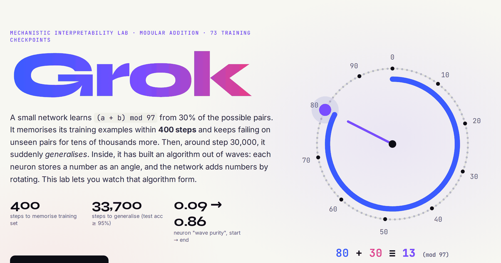

# Grok: watching a neural network suddenly understand

**Live:** https://rishikeshn-eng.github.io/grok-interpretability-lab/

A mechanistic interpretability lab about **grokking**. A small network learns `(a + b) mod 97` from 30% of the 9,409 possible pairs. It memorises its training set within **400 steps**, stays at chance on unseen pairs for tens of thousands of steps, then generalises suddenly at around **33,700 steps**. Inside, it has built an algorithm out of Fourier waves. You can scrub through all 73 checkpoints and watch that happen.

## What you can do

- **Timeline.** A 97 × 97 grid of every question, animated across training (green = correct). Linked train and test accuracy curves come with a running phase commentary: memorise, circuit formation, clean-up, generalise.
- **Inside the weights.** An animated heatmap of all 256 neurons' input weights next to their Fourier spectra. Noise turns into single-frequency waves.
- **Progress measure.** Median "wave purity" rises from **0.09 to 0.86**, and it starts rising long before test accuracy moves (after Nanda et al., 2023).
- **Open one neuron.** Fit a cosine to its weights (R² about 0.9) and see its activation over every (a, b) as diagonal stripes, which means it depends only on a + b.
- **Run and ablate.** The final network runs live in the browser. Knock out whole frequency groups and re-score all 9,409 pairs. Removing half the frequencies still leaves about 70% accuracy, so the algorithm is spread across all 48 frequencies rather than stored as a lookup table.

## How it was built

`train.py` is a one-hidden-layer MLP (256 ReLU units, separate embeddings for a and b) written **from scratch in NumPy**: full-batch AdamW, lr 1e-3, weight decay 1.0, 40,000 steps on CPU. `analyse.py` extracts the Fourier analysis, 73 int8 weight snapshots and bit-packed correctness grids. The final model gets 98.8% of all pairs right and 98.3% of held-out pairs.

## References

Power et al. (2022) *Grokking* · Nanda et al. (ICLR 2023) *Progress Measures for Grokking via Mechanistic Interpretability* · Gromov (2023) *Grokking modular arithmetic* · Liu et al. (ICLR 2023) *Omnigrok* · Zhong et al. (NeurIPS 2023) *The Clock and the Pizza*

Run locally with `python3 -m http.server`. Code is MIT-licensed.
